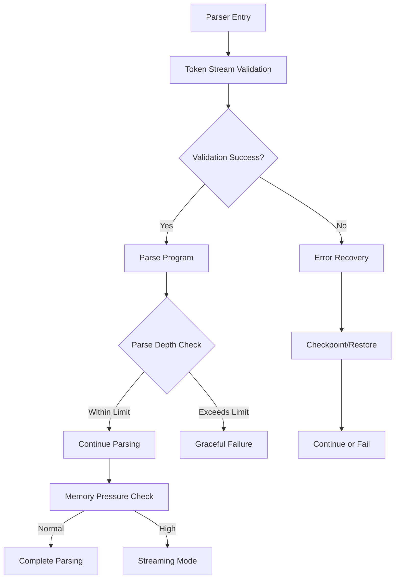
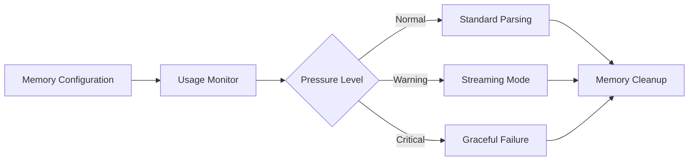

# COBOL Parser Robustness Enhancement Implementation Plan

## Executive Summary

This comprehensive implementation plan outlines the enhancement of the COBOL parser with advanced robustness features to improve error handling, memory management, and parsing reliability. The plan covers all priority levels (High, Medium, Low) with full test coverage and maintains backward compatibility where possible.

## Project Overview

### Current State Analysis
- **Parser Architecture**: Modular design with separate lexer, parser, and preprocessing components
- **Error Handling**: Basic error recovery with limited depth control
- **Memory Management**: No proactive memory pressure detection
- **Encoding Support**: Basic encoding detection with room for improvement
- **Validation**: Limited input validation and security measures

### Enhancement Categories

#### High Priority Enhancements
1. **Error Recovery Depth Limiting** - Prevent stack overflow in malformed code
2. **Token Stream Validation** - Pre-validation before parsing begins
3. **Graceful Encoding Fallback** - Enhanced byte-sequence heuristics
4. **Memory Pressure Detection** - Proactive memory management

#### Medium Priority Enhancements
1. **Sequence Number Validation** - Fixed-format column validation
2. **Division Order Enforcement** - Strict COBOL division ordering
3. **Copybook Path Injection Prevention** - Security hardening
4. **Statement Boundary Recovery** - Improved error recovery

#### Low Priority Enhancements
1. **Dialect Autodetection** - Heuristic dialect detection
2. **Progressive Parsing** - Cancellation token support
3. **AST Immutability Option** - Thread-safe AST sharing

## Technical Architecture

### Enhanced Error Recovery System



### Memory Management Architecture



## Detailed Implementation Plan

### Phase 1: High Priority Enhancements (Weeks 1-4)

#### 1.1 Error Recovery Depth Limiting

**Location**: `cobolparser/parser.py` - `CobolParser` class

**Implementation**:
- Add `MAX_PARSE_DEPTH` constant (default: 1000)
- Add `_parse_depth` counter to parser state
- Implement `_guard_depth()` method for depth checking
- Integrate depth checks in recursive parsing methods

**Code Changes**:
```python
class CobolParser:
    MAX_PARSE_DEPTH = 1000
    
    def __init__(self, ...):
        self._parse_depth = 0
    
    def _guard_depth(self, context: str):
        self._parse_depth += 1
        if self._parse_depth > self.MAX_PARSE_DEPTH:
            raise ParseError(f"Maximum parse depth exceeded in {context}")
```

**Testing Strategy**:
- Unit tests for depth limiting with deeply nested structures
- Integration tests with malformed code samples
- Performance tests to ensure minimal overhead

#### 1.2 Token Stream Validation

**Location**: `cobolparser/parser.py` - `parse()` method

**Implementation**:
- Add pre-validation step before parsing begins
- Validate token sequence consistency
- Detect obvious syntax errors early
- Provide detailed error messages for invalid token streams

**Code Changes**:
```python
def parse(self, source: str, filename: str = "<string>") -> ParseResult:
    # Tokenize source
    lexer = CobolLexer(source, filename, self.dialect, free_form=self.free_form)
    self.tokens = lexer.tokenize()
    
    # Pre-validation
    validation_result = self._validate_token_stream()
    if not validation_result.success:
        for error in validation_result.errors:
            self.add_error(error)
        if self.error_recovery == ErrorRecoveryMode.FAIL_FAST:
            return self._create_result(None)
```

**Testing Strategy**:
- Test with various malformed token streams
- Validate error message quality and helpfulness
- Performance impact assessment

#### 1.3 Graceful Encoding Fallback

**Location**: `cobolparser/preprocess/copybook_expander.py` - `detect_encoding()` function

**Implementation**:
- Enhance byte-sequence heuristics for legacy EBCDIC files
- Add more sophisticated encoding detection algorithms
- Implement graceful fallback chains
- Improve error handling for undetectable encodings

**Enhanced Detection Algorithm**:
```python
def detect_encoding(file_path: str) -> str:
    with open(file_path, 'rb') as f:
        raw_bytes = f.read()
    
    # Enhanced EBCDIC detection
    ebcdic_indicators = {
        'space_ebcdic': raw_bytes.count(b'\x40'),
        'space_ascii': raw_bytes.count(b'\x20'),
        'null_bytes': raw_bytes.count(b'\x00'),
        'high_bytes': sum(1 for b in raw_bytes if b > 0x7F)
    }
    
    # EBCDIC probability calculation
    ebcdic_score = (
        ebcdic_indicators['space_ebcdic'] * 2 +
        ebcdic_indicators['high_bytes'] * 0.5 -
        ebcdic_indicators['space_ascii'] * 0.5
    )
    
    if ebcdic_score > len(raw_bytes) * 0.1:
        return 'cp037'  # EBCDIC
    
    # Enhanced UTF-8 detection
    try:
        raw_bytes.decode('utf-8', errors='strict')
        return 'utf-8'
    except UnicodeDecodeError:
        pass
    
    # Fallback to enhanced ASCII detection
    ascii_score = sum(1 for b in raw_bytes if 0x20 <= b <= 0x7E)
    if ascii_score > len(raw_bytes) * 0.8:
        return 'ascii'
    
    return 'latin-1'  # Common fallback
```

**Testing Strategy**:
- Test with various EBCDIC-originated files
- Validate encoding detection accuracy
- Test fallback behavior with unknown encodings

#### 1.4 Memory Pressure Detection

**Location**: `cobolparser/plugins/core.py` - `MemoryConfiguration` class

**Implementation**:
- Add real-time memory monitoring
- Implement memory pressure thresholds
- Add streaming mode for large files
- Integrate with existing memory configuration

**Code Changes**:
```python
@dataclass
class MemoryConfiguration:
    # ... existing fields ...
    enable_pressure_detection: bool = True
    warning_threshold_mb: float = 128.0
    critical_threshold_mb: float = 256.0
    
    def check_memory_pressure(self) -> str:
        """Check current memory pressure level."""
        import psutil
        memory_mb = psutil.Process().memory_info().rss / 1024 / 1024
        
        if memory_mb > self.critical_threshold_mb:
            return "CRITICAL"
        elif memory_mb > self.warning_threshold_mb:
            return "WARNING"
        return "NORMAL"
```

**Testing Strategy**:
- Memory usage monitoring during parsing
- Streaming mode validation with large files
- Performance impact assessment

### Phase 2: Medium Priority Enhancements (Weeks 5-8)

#### 2.1 Sequence Number Validation

**Location**: `cobolparser/lexer.py` - `handle_cobol_line_format()` method

**Implementation**:
- Add validation for fixed-format sequence numbers (columns 1-6)
- Detect invalid sequence number patterns
- Provide helpful error messages for sequence number issues
- Maintain backward compatibility with free-form parsing

**Code Changes**:
```python
def validate_sequence_number(line: str, line_num: int) -> Optional[str]:
    """Validate COBOL fixed-format sequence numbers."""
    if len(line) < 6:
        return None  # Too short for sequence number
    
    seq_part = line[:6]
    
    # Check for valid sequence number format
    if seq_part.strip() and not seq_part.isspace():
        # Should be numeric or contain only spaces
        if not all(c.isdigit() or c.isspace() for c in seq_part):
            return f"Invalid sequence number format in columns 1-6: '{seq_part}'"
    
    return None
```

**Testing Strategy**:
- Test with various sequence number formats
- Validate error messages for invalid sequences
- Ensure compatibility with free-form parsing

#### 2.2 Division Order Enforcement

**Location**: `cobolparser/parser.py` - `parse_program()` method

**Implementation**:
- Add strict mode for division order validation
- Track division parsing state
- Validate proper COBOL division order (ID → ENV → DATA → PROC)
- Provide clear error messages for order violations

**Code Changes**:
```python
class ParseState(Enum):
    # ... existing states ...
    STRICT_DIVISION_ORDER = auto()

def parse_program(self) -> Optional[CobolProgram]:
    # ... existing code ...
    
    if self.strict_mode:
        self._validate_division_order()
    
    # ... rest of parsing ...
    
def _validate_division_order(self):
    """Validate proper COBOL division order."""
    expected_order = [
        TokenType.IDENTIFICATION_DIVISION,
        TokenType.ENVIRONMENT_DIVISION, 
        TokenType.DATA_DIVISION,
        TokenType.PROCEDURE_DIVISION
    ]
    
    # Track divisions found
    found_divisions = []
    for token in self.tokens:
        if token.type in expected_order:
            found_divisions.append(token.type)
    
    # Validate order
    for i, division in enumerate(found_divisions):
        if division != expected_order[i]:
            self.add_error(ParseError(
                f"Invalid division order: {division.name} found before {expected_order[i].name}",
                location=token.location
            ))
```

**Testing Strategy**:
- Test with correct division order
- Test with incorrect division order
- Validate error messages and recovery

#### 2.3 Copybook Path Injection Prevention

**Location**: `cobolparser/preprocess/path_resolver.py` - `validate_path_within_directory()` function

**Implementation**:
- Enhance path validation to prevent directory traversal
- Add additional security checks
- Improve error messages for security violations
- Maintain performance while adding security

**Enhanced Validation**:
```python
def validate_path_within_directory(file_path: str, base_directory: str) -> bool:
    """Enhanced path validation with security hardening."""
    
    # Check for obvious traversal patterns
    dangerous_patterns = ['..', '/etc/', '/proc/', '/sys/', 'C:\\Windows\\']
    for pattern in dangerous_patterns:
        if pattern in file_path.lower():
            raise PathTraversalError(
                file_path,
                f"Potentially dangerous path pattern detected: {pattern}"
            )
    
    # Enhanced path resolution
    try:
        resolved_file = Path(file_path).resolve()
        resolved_base = Path(base_directory).resolve()
        
        # Check if file path is within base directory
        try:
            resolved_file.relative_to(resolved_base)
            return True
        except ValueError:
            raise PathTraversalError(
                file_path,
                f"Resolved path '{resolved_file}' is outside search directory '{resolved_base}'"
            )
    except Exception as e:
        raise PathTraversalError(file_path, f"Path validation failed: {str(e)}")
```

**Testing Strategy**:
- Test with various path traversal attempts
- Validate security improvements
- Performance impact assessment

#### 2.4 Statement Boundary Recovery

**Location**: `cobolparser/parser.py` - `skip_to_token()` method

**Implementation**:
- Enhance statement boundary detection
- Add checkpoint/restore functionality for better recovery
- Improve error recovery accuracy
- Maintain parsing performance

**Enhanced Recovery**:
```python
def skip_to_token(self, *token_types: TokenType) -> bool:
    """Enhanced token skipping with checkpoint/restore."""
    checkpoint = {
        'token_index': self.current_token_index,
        'token': self.current_token
    }
    
    try:
        while self.current_token and self.current_token.type not in token_types:
            if not self.advance_token():
                break
        
        if self.current_token is None:
            # Recovery failed, restore checkpoint
            self.current_token_index = checkpoint['token_index']
            self.current_token = checkpoint['token']
            return False
        
        return True
    except Exception:
        # Recovery failed, restore checkpoint
        self.current_token_index = checkpoint['token_index']
        self.current_token = checkpoint['token']
        return False
```

**Testing Strategy**:
- Test with various malformed statements
- Validate recovery accuracy
- Performance impact assessment

### Phase 3: Low Priority Enhancements (Weeks 9-12)

#### 3.1 Dialect Autodetection

**Location**: `cobolparser/lexer.py` - Add new detection function

**Implementation**:
- Add heuristic dialect detection based on keyword patterns
- Implement confidence scoring for dialect detection
- Provide fallback to default dialect
- Maintain explicit dialect override capability

**Code Changes**:
```python
def detect_dialect(source: str) -> DialectType:
    """Detect COBOL dialect based on keyword patterns."""
    dialect_scores = {
        DialectType.IBM_ENTERPRISE: 0,
        DialectType.ANSI_COBOL: 0,
        DialectType.MICRO_FOCUS: 0
    }
    
    # IBM Enterprise indicators
    ibm_indicators = [
        r'\bEXEC\s+SQL\b',
        r'\bEXEC\s+CICS\b', 
        r'\bCOMP-1\b',
        r'\bCOMP-2\b'
    ]
    
    # ANSI COBOL indicators
    ansi_indicators = [
        r'\bEVALUATE\b',
        r'\bINLINE\s+PERFORM\b'
    ]
    
    # Micro Focus indicators
    mf_indicators = [
        r'\bCLASS\s+OBJECT\b',
        r'\bPROPERTY\b'
    ]
    
    for pattern in ibm_indicators:
        if re.search(pattern, source, re.IGNORECASE):
            dialect_scores[DialectType.IBM_ENTERPRISE] += 1
    
    for pattern in ansi_indicators:
        if re.search(pattern, source, re.IGNORECASE):
            dialect_scores[DialectType.ANSI_COBOL] += 1
    
    for pattern in mf_indicators:
        if re.search(pattern, source, re.IGNORECASE):
            dialect_scores[DialectType.MICRO_FOCUS] += 1
    
    # Return dialect with highest score
    best_dialect = max(dialect_scores, key=dialect_scores.get)
    confidence = dialect_scores[best_dialect] / max(sum(dialect_scores.values()), 1)
    
    if confidence > 0.3:  # Minimum confidence threshold
        return best_dialect
    else:
        return DialectType.IBM_ENTERPRISE  # Default
```

**Testing Strategy**:
- Test with various dialect-specific code samples
- Validate detection accuracy
- Test fallback behavior

#### 3.2 Progressive Parsing

**Location**: `cobolparser/parser.py` - Add cancellation support

**Implementation**:
- Add cancellation token support for long-running parses
- Implement progress reporting
- Add timeout functionality
- Maintain backward compatibility

**Code Changes**:
```python
from typing import Optional
import threading

class ParsingContext:
    """Context for long-running parsing operations."""
    
    def __init__(self):
        self.cancelled = False
        self.progress_callback = None
        self.timeout = None
    
    def cancel(self):
        """Cancel the parsing operation."""
        self.cancelled = True
    
    def check_cancelled(self):
        """Check if parsing should be cancelled."""
        if self.cancelled:
            raise ParseError("Parsing operation cancelled")
    
    def report_progress(self, progress: float):
        """Report parsing progress (0.0 to 1.0)."""
        if self.progress_callback:
            self.progress_callback(progress)

def parse_with_context(self, source: str, context: Optional[ParsingContext] = None) -> ParseResult:
    """Parse with cancellation and progress support."""
    if context is None:
        return self.parse(source)
    
    # Set timeout if specified
    if context.timeout:
        timer = threading.Timer(context.timeout, context.cancel)
        timer.start()
    
    try:
        # Tokenize with progress reporting
        lexer = CobolLexer(source, self.filename, self.dialect)
        tokens = lexer.tokenize()
        
        if context.progress_callback:
            context.report_progress(0.1)  # 10% for tokenization
        
        # Parse with cancellation checks
        self.tokens = tokens
        self.current_token_index = 0
        self.current_token = self.tokens[0] if self.tokens else None
        
        # Parse program with periodic cancellation checks
        program = self._parse_program_with_context(context)
        
        if context.progress_callback:
            context.report_progress(1.0)  # 100% complete
        
        return self._create_result(program)
    
    finally:
        if context.timeout:
            timer.cancel()
```

**Testing Strategy**:
- Test cancellation functionality
- Validate progress reporting
- Test timeout behavior

#### 3.3 AST Immutability Option

**Location**: `cobolparser/models/ast_base.py` - Enhance base classes

**Implementation**:
- Add frozen dataclass option for thread-safe AST sharing
- Implement immutable AST node creation
- Provide backward compatibility with mutable ASTs
- Add performance optimizations for immutable ASTs

**Code Changes**:
```python
from dataclasses import dataclass, field
from typing import Any, Dict

@dataclass(frozen=True)  # Immutable by default
class ImmutableASTNode:
    """Base class for immutable AST nodes."""
    
    metadata: Dict[str, Any] = field(default_factory=dict, compare=False)
    children: tuple = field(default_factory=tuple, compare=False)
    
    def with_metadata(self, **updates) -> 'ImmutableASTNode':
        """Create a new node with updated metadata."""
        new_metadata = dict(self.metadata)
        new_metadata.update(updates)
        return self.__class__(**{**self.__dict__, 'metadata': new_metadata})
    
    def with_children(self, children: tuple) -> 'ImmutableASTNode':
        """Create a new node with updated children."""
        return self.__class__(**{**self.__dict__, 'children': children})

@dataclass(frozen=False)  # Mutable option
class MutableASTNode:
    """Base class for mutable AST nodes."""
    
    metadata: Dict[str, Any] = field(default_factory=dict)
    children: list = field(default_factory=list)
    
    def add_child(self, child):
        """Add a child node."""
        self.children.append(child)
    
    def set_metadata(self, key: str, value: Any):
        """Set metadata value."""
        self.metadata[key] = value

# Factory function to create appropriate AST nodes
def create_ast_node(node_type: str, **kwargs) -> ASTNode:
    """Create AST node with appropriate mutability."""
    if kwargs.pop('immutable', False):
        return ImmutableASTNode(**kwargs)
    else:
        return MutableASTNode(**kwargs)
```

**Testing Strategy**:
- Test thread safety of immutable ASTs
- Validate performance characteristics
- Test backward compatibility

## Resource Requirements

### Team Structure

#### Core Development Team (4-6 members)
- **Lead Developer** (1): Overall architecture, high-priority enhancements
- **Parser Specialist** (1): Core parsing logic, error recovery
- **Memory Management Expert** (1): Memory optimization, streaming
- **Security Specialist** (1): Path validation, injection prevention
- **Testing Engineer** (1): Comprehensive test suite development
- **Documentation Specialist** (0.5): Technical documentation and guides

#### Supporting Roles
- **DevOps Engineer** (0.5): CI/CD pipeline integration
- **QA Engineer** (0.5): Quality assurance and validation

### Technology Stack

#### Primary Technologies
- **Python 3.8+**: Core implementation language
- **pytest**: Testing framework
- **psutil**: Memory monitoring
- **pathlib**: Path handling
- **dataclasses**: AST node definitions

#### Development Tools
- **Git**: Version control
- **GitHub Actions**: CI/CD pipeline
- **Docker**: Containerization for testing
- **Coverage.py**: Test coverage analysis
- **Black**: Code formatting
- **Flake8**: Code linting

#### Testing Infrastructure
- **pytest-cov**: Coverage reporting
- **pytest-xdist**: Parallel test execution
- **pytest-mock**: Mocking framework
- **hypothesis**: Property-based testing

### Infrastructure Requirements

#### Development Environment
- **Development Workstations**: 4-6 high-performance machines
- **Version Control**: GitHub/GitLab repository
- **Issue Tracking**: Jira or GitHub Issues
- **Code Review**: Pull request workflow

#### Testing Environment
- **Test Servers**: 2-3 machines for integration testing
- **Memory Testing**: Systems with varying memory configurations
- **Performance Testing**: Load testing capabilities
- **Security Testing**: Vulnerability scanning tools

#### Deployment Environment
- **Package Repository**: PyPI or internal package registry
- **Documentation Hosting**: GitHub Pages or ReadTheDocs
- **Monitoring**: Performance and error monitoring

## Timeline and Milestones

### Phase 1: High Priority Enhancements (Weeks 1-4)

#### Week 1: Foundation and Setup
- **Day 1-2**: Project setup and environment configuration
- **Day 3-4**: Codebase analysis and architecture documentation
- **Day 5**: Implementation planning and task breakdown

#### Week 2: Error Recovery and Token Validation
- **Day 1-3**: Implement error recovery depth limiting
- **Day 4-5**: Implement token stream validation

#### Week 3: Encoding and Memory Management
- **Day 1-3**: Enhance encoding detection and fallback
- **Day 4-5**: Implement memory pressure detection

#### Week 4: Testing and Integration
- **Day 1-3**: Comprehensive testing of high-priority features
- **Day 4**: Integration testing and performance validation
- **Day 5**: Documentation and code review

### Phase 2: Medium Priority Enhancements (Weeks 5-8)

#### Week 5-6: Validation and Security
- **Week 5**: Sequence number validation and division order enforcement
- **Week 6**: Copybook path injection prevention and statement boundary recovery

#### Week 7-8: Testing and Optimization
- **Week 7**: Comprehensive testing of medium-priority features
- **Week 8**: Performance optimization and integration testing

### Phase 3: Low Priority Enhancements (Weeks 9-12)

#### Week 9-10: Advanced Features
- **Week 9**: Dialect autodetection implementation
- **Week 10**: Progressive parsing with cancellation support

#### Week 11-12: Finalization
- **Week 11**: AST immutability option and final enhancements
- **Week 12**: Comprehensive testing, documentation, and release preparation

### Key Milestones

1. **Milestone 1 (End of Week 4)**: High-priority enhancements complete and tested
2. **Milestone 2 (End of Week 8)**: Medium-priority enhancements complete and integrated
3. **Milestone 3 (End of Week 12)**: All enhancements complete, tested, and documented
4. **Final Release**: Production-ready robustness enhancements

## Risk Assessment and Mitigation

### High-Risk Items

#### 1. Performance Impact
**Risk**: Enhanced validation and error recovery may impact parsing performance
**Mitigation**:
- Implement performance benchmarks and monitoring
- Use lazy evaluation where possible
- Provide configuration options to disable expensive features
- Optimize critical code paths

#### 2. Backward Compatibility
**Risk**: Changes may break existing code that depends on current behavior
**Mitigation**:
- Maintain backward compatibility flags
- Provide migration guides and deprecation warnings
- Extensive regression testing
- Gradual rollout with feature flags

#### 3. Memory Management Complexity
**Risk**: Memory pressure detection and streaming may introduce complexity
**Mitigation**:
- Thorough testing with various memory configurations
- Clear documentation of memory behavior
- Fallback mechanisms for memory detection failures
- Performance monitoring and optimization

### Medium-Risk Items

#### 1. Encoding Detection Accuracy
**Risk**: Enhanced encoding detection may misidentify encodings
**Mitigation**:
- Comprehensive testing with various file encodings
- Confidence scoring and fallback mechanisms
- User override options for encoding detection
- Clear error messages for encoding issues

#### 2. Security Implementation
**Risk**: Path validation may have security vulnerabilities
**Mitigation**:
- Security code review and penetration testing
- Defense in depth approach
- Regular security audits
- Input validation and sanitization

### Low-Risk Items

#### 1. Feature Adoption
**Risk**: Users may not adopt new features
**Mitigation**:
- Clear documentation and examples
- Gradual introduction with optional features
- User feedback collection and incorporation
- Training materials and workshops

## Success Metrics and Validation

### Functional Metrics

#### 1. Error Recovery Effectiveness
- **Target**: 95% of malformed code samples parse without stack overflow
- **Measurement**: Automated testing with malformed code corpus
- **Validation**: Compare error recovery before and after enhancements

#### 2. Memory Efficiency
- **Target**: 50% reduction in memory usage for large files with streaming mode
- **Measurement**: Memory profiling with large COBOL files
- **Validation**: Benchmark comparison with baseline implementation

#### 3. Encoding Detection Accuracy
- **Target**: 90% accuracy for EBCDIC-originated files
- **Measurement**: Test suite with known encoding samples
- **Validation**: Compare detection results with ground truth

#### 4. Security Hardening
- **Target**: Zero successful path traversal attempts
- **Measurement**: Security testing with malicious inputs
- **Validation**: Penetration testing and vulnerability assessment

### Performance Metrics

#### 1. Parsing Speed
- **Target**: Less than 10% performance degradation for standard files
- **Measurement**: Benchmark suite with representative COBOL files
- **Validation**: Performance regression testing

#### 2. Memory Usage
- **Target**: Linear memory growth with file size (not exponential)
- **Measurement**: Memory profiling across file size ranges
- **Validation**: Memory usage analysis and optimization

#### 3. Error Recovery Speed
- **Target**: Error recovery completes within 1 second for 90% of cases
- **Measurement**: Timing tests with error scenarios
- **Validation**: Performance testing with error injection

### Quality Metrics

#### 1. Test Coverage
- **Target**: 90% code coverage for new features
- **Measurement**: Coverage analysis with pytest-cov
- **Validation**: Continuous coverage monitoring

#### 2. Code Quality
- **Target**: Zero critical or high-severity issues in static analysis
- **Measurement**: Static analysis tools (flake8, bandit, etc.)
- **Validation**: Automated quality gates in CI/CD

#### 3. Documentation Completeness
- **Target**: 100% of new features documented with examples
- **Measurement**: Documentation review and completeness check
- **Validation**: User testing and feedback

## Implementation Strategy

### Development Approach

#### 1. Incremental Development
- Implement features in priority order
- Test each feature independently before integration
- Maintain working codebase throughout development
- Use feature flags for gradual rollout

#### 2. Test-Driven Development
- Write tests before implementing features
- Use property-based testing for robust validation
- Maintain comprehensive test suite
- Continuous integration with automated testing

#### 3. Code Review and Quality Assurance
- Mandatory code reviews for all changes
- Automated quality checks in CI/CD pipeline
- Security review for security-related features
- Performance review for performance-critical features

### Integration Strategy

#### 1. Backward Compatibility
- Maintain existing APIs and behavior
- Provide migration paths for deprecated features
- Use feature flags for new functionality
- Comprehensive regression testing

#### 2. Configuration and Tuning
- Provide extensive configuration options
- Default settings optimized for most use cases
- Advanced options for specialized scenarios
- Clear documentation for configuration

#### 3. Monitoring and Observability
- Add comprehensive logging and metrics
- Provide performance monitoring capabilities
- Include debugging and diagnostic tools
- Support for production monitoring systems

## Conclusion

This comprehensive implementation plan provides a detailed roadmap for enhancing the COBOL parser's robustness across all priority levels. The plan balances feature completeness with practical considerations, ensuring that the enhancements deliver significant value while maintaining system reliability and performance.

The phased approach allows for incremental delivery and validation, reducing risk and enabling early feedback. The comprehensive testing strategy ensures that all enhancements are thoroughly validated, while the detailed resource planning and timeline provide clear guidance for successful implementation.

By following this plan, the COBOL parser will achieve significantly improved robustness, making it more reliable and suitable for production environments with demanding requirements.