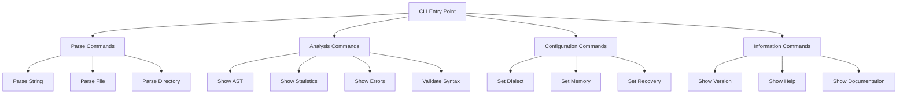

# COBOL Parser CLI Implementation Plan

## Executive Summary

This plan outlines the implementation of a comprehensive Command-Line Interface (CLI) for the COBOL parser, providing users with powerful tools to interact with the parser, analyze COBOL source code, and manage parsing operations through an intuitive command-line interface.

## Current State Analysis

### Existing Infrastructure
- **Parser Core**: Well-structured Python package with modular architecture
- **Entry Points**: Multiple parsing methods documented in PARSER_INVOCATION_GUIDE.md
- **CLI Module**: Basic coverage CLI already exists in `cobolparser/cli/coverage.py`
- **Documentation**: Comprehensive parser documentation available

### Project Structure
```
cobolparser/
├── cli/
│   └── coverage.py          # Existing IO coverage CLI
├── parser.py                # Main parser implementation
├── cli/__init__.py          # CLI package initialization
└── docs/PARSER_INVOCATION_GUIDE.md  # Parser documentation
```

## CLI Architecture Design

### 1. Command Structure



### 2. Core Components

#### a) CLI Entry Point
- **File**: `cobolparser/cli/__main__.py`
- **Purpose**: Main entry point for CLI execution
- **Features**: Argument parsing, command routing, error handling

#### b) Command Modules
- **File**: `cobolparser/cli/commands/`
- **Structure**: Separate modules for each command category
- **Benefits**: Modular, maintainable, testable

#### c) Parser Integration Layer
- **File**: `cobolparser/cli/parser_interface.py`
- **Purpose**: Bridge between CLI and parser core
- **Features**: Configuration management, result formatting

### 3. Command Categories

#### Parse Commands
```bash
# Parse COBOL code from string
cobol parse string "...COBOL code..."

# Parse COBOL file
cobol parse file path/to/program.cbl

# Parse directory of COBOL files
cobol parse dir path/to/cobol/files --recursive
```

#### Analysis Commands
```bash
# Show Abstract Syntax Tree
cobol analyze ast path/to/program.cbl --format json

# Show parsing statistics
cobol analyze stats path/to/program.cbl

# Show errors and warnings
cobol analyze errors path/to/program.cbl

# Validate COBOL syntax
cobol analyze validate path/to/program.cbl
```

#### Configuration Commands
```bash
# Set COBOL dialect
cobol config dialect set ibm_enterprise

# Set memory configuration
cobol config memory set 1024

# Set error recovery mode
cobol config recovery set collect_all
```

#### Information Commands
```bash
# Show CLI version
cobol info version

# Show parser version
cobol info parser-version

# Show documentation
cobol info docs
```

## Implementation Phases

### Phase 1: Foundation Setup (Week 1)

#### 1.1 Project Structure
- [ ] Create CLI package structure
- [ ] Set up command modules directory
- [ ] Create parser interface module
- [ ] Add CLI entry point

#### 1.2 Core Infrastructure
- [ ] Implement argument parsing framework
- [ ] Create base command classes
- [ ] Set up error handling system
- [ ] Implement logging configuration

#### 1.3 Basic Commands
- [ ] Implement `parse string` command
- [ ] Implement `parse file` command
- [ ] Implement `info version` command
- [ ] Implement basic help system

### Phase 2: Advanced Features (Week 2)

#### 2.1 Analysis Commands
- [ ] Implement AST display command
- [ ] Implement statistics command
- [ ] Implement error reporting command
- [ ] Implement syntax validation command

#### 2.2 Configuration Management
- [ ] Implement dialect configuration
- [ ] Implement memory configuration
- [ ] Implement error recovery configuration
- [ ] Add configuration persistence

#### 2.3 Output Formatting
- [ ] Implement JSON output format
- [ ] Implement table output format
- [ ] Implement pretty-print output
- [ ] Add colorized output for terminals

### Phase 3: Polish & Integration (Week 3)

#### 3.1 User Experience
- [ ] Implement auto-completion support
- [ ] Add command aliases
- [ ] Create comprehensive help system
- [ ] Add examples and usage guides

#### 3.2 Integration
- [ ] Integrate with existing coverage CLI
- [ ] Add batch processing capabilities
- [ ] Implement progress indicators
- [ ] Add performance optimizations

#### 3.3 Documentation
- [ ] Create CLI user guide
- [ ] Add command reference documentation
- [ ] Create examples and tutorials
- [ ] Update project documentation

## Technical Specifications

### 1. Dependencies
```python
# Required dependencies
argparse>=1.1
rich>=13.0.0  # For enhanced terminal output
pyyaml>=6.0   # For configuration management
```

### 2. Entry Point Configuration
```python
# setup.py or pyproject.toml
[options.entry_points]
console_scripts =
    cobol = cobolparser.cli.__main__:main
```

### 3. Command Interface
```python
class BaseCommand:
    def __init__(self, args: argparse.Namespace):
        self.args = args
        
    def execute(self) -> int:
        """Execute the command and return exit code."""
        raise NotImplementedError
    
    def validate(self) -> bool:
        """Validate command arguments."""
        return True
```

### 4. Parser Integration
```python
class ParserInterface:
    def __init__(self, config: Dict[str, Any]):
        self.config = config
        self.parser = None
        
    def create_parser(self) -> CobolParser:
        """Create configured parser instance."""
        return CobolParser(
            dialect=self.config['dialect'],
            error_recovery=self.config['error_recovery'],
            memory_config=MemoryConfiguration(
                max_memory_mb=self.config['memory_mb']
            )
        )
```

## Best Practices Implementation

### 1. Error Handling
- Comprehensive error classification
- User-friendly error messages
- Stack trace control for production
- Graceful degradation

### 2. Input Validation
- File existence checks
- Format validation
- Permission verification
- Resource limits enforcement

### 3. Performance Optimization
- Lazy loading of commands
- Caching of parser instances
- Progress indicators for long operations
- Memory usage monitoring

### 4. Security Considerations
- Input sanitization
- File path validation
- Resource limits enforcement
- Safe execution environment

## Scalability Considerations

### 1. Command Extensibility
- Plugin architecture for custom commands
- Dynamic command loading
- Configuration-driven command registration

### 2. Performance Scaling
- Batch processing support
- Parallel execution capabilities
- Memory-efficient parsing
- Streaming output for large files

### 3. Configuration Management
- Hierarchical configuration system
- Environment variable support
- Configuration file support
- Runtime configuration changes

## Testing Strategy

### 1. Unit Tests
- Command execution tests
- Argument parsing tests
- Error handling tests
- Integration tests with parser

### 2. Integration Tests
- End-to-end CLI workflows
- Configuration management tests
- Performance tests
- Cross-platform compatibility tests

### 3. User Acceptance Tests
- Real-world usage scenarios
- Edge case handling
- Performance benchmarks
- Usability testing

## Deployment & Distribution

### 1. Packaging
- PyPI distribution
- Wheel format support
- Platform-specific builds
- Dependency management

### 2. Installation
- pip installation support
- Virtual environment compatibility
- System package integration
- Development installation

### 3. Updates
- Version management
- Update notification system
- Backward compatibility
- Migration support

## Success Metrics

### 1. Performance Metrics
- Command execution time
- Memory usage
- Resource utilization
- Throughput rates

### 2. User Experience Metrics
- Command success rate
- Error rate
- User satisfaction
- Adoption rate

### 3. Quality Metrics
- Test coverage
- Bug rate
- Documentation completeness
- Maintenance effort

## Risk Mitigation

### 1. Technical Risks
- Parser API changes
- Dependency conflicts
- Performance bottlenecks
- Platform compatibility issues

### 2. User Experience Risks
- Complex command structure
- Poor error messages
- Inconsistent behavior
- Performance issues

### 3. Project Risks
- Scope creep
- Timeline delays
- Resource constraints
- Quality compromises

## Conclusion

This comprehensive CLI implementation plan provides a solid foundation for creating a powerful, user-friendly command-line interface for the COBOL parser. The phased approach ensures manageable development while delivering value at each stage. The focus on best practices, scalability, and user experience will result in a high-quality tool that enhances the COBOL parser's usability and accessibility.

## Next Steps

1. Review and approve this implementation plan
2. Begin Phase 1: Foundation Setup
3. Establish development environment and tooling
4. Implement core infrastructure components
5. Create initial command implementations
6. Set up testing framework and CI/CD pipeline

---

*Plan Version: 1.0*
*Last Updated: 2026-02-02*
*Author: Kilo Code - Technical Architect*