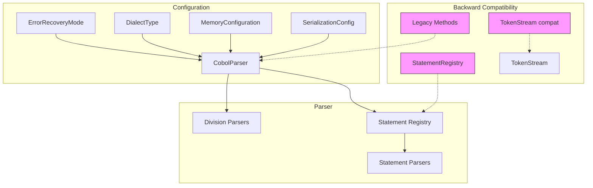

# COBOL Parser Feature Flags and Backward Compatibility Analysis

## Executive Summary

This document provides a comprehensive analysis of all feature flags, backward compatibility mechanisms, and legacy support patterns in the COBOL parser codebase. The analysis identifies configuration options, compatibility layers, and provides recommendations for cleanup.

---

## 1. Feature Toggles and Configuration Options

### 1.1 Error Recovery Mode

| Property | Value |
|----------|-------|
| **Location** | [`cobolparser/plugins/core.py:16-20`](cobolparser/plugins/core.py:16) |
| **Type** | Enum: `ErrorRecoveryMode` |
| **Default** | `FAIL_FAST` |
| **Options** | `FAIL_FAST`, `COLLECT_ALL` |

**Functionality:**
- `FAIL_FAST`: Stop parsing on first error
- `COLLECT_ALL`: Collect all errors, continue parsing for comprehensive reporting

**Version Compatibility:** v1.0.0+

---

### 1.2 Dialect Type

| Property | Value |
|----------|-------|
| **Location** | [`cobolparser/plugins/core.py:23-28`](cobolparser/plugins/core.py:23) |
| **Type** | Enum: `DialectType` |
| **Default** | `IBM_ENTERPRISE` |
| **Options** | `IBM_ENTERPRISE`, `ANSI_COBOL`, `MICRO_FOCUS` |

**Functionality:** Selects COBOL dialect for parsing rules and validation

**Version Compatibility:** v1.0.0+ (IBM Enterprise is primary dialect)

---

### 1.3 Memory Configuration

| Property | Value |
|----------|-------|
| **Location** | [`cobolparser/plugins/core.py:31-52`](cobolparser/plugins/core.py:31) |
| **Type** | Dataclass: `MemoryConfiguration` |

**Fields:**
| Field | Type | Default | Range |
|-------|------|---------|-------|
| `max_memory_mb` | int | 256 | 64-8192 |
| `enable_streaming` | bool | False | - |
| `chunk_size_kb` | int | 512 | >0 |

**Functionality:** Controls memory management for parsing large COBOL programs

**Version Compatibility:** v1.0.0+

---

### 1.4 Serialization Configuration

| Property | Value |
|----------|-------|
| **Location** | [`cobolparser/plugins/core.py:55-66`](cobolparser/plugins/core.py:55) |
| **Type** | Dataclass: `SerializationConfig` |

**Fields:**
| Field | Type | Default |
|-------|------|---------|
| `include_metadata` | bool | True |
| `include_source_locations` | bool | True |
| `compact_format` | bool | False |

**Functionality:** Controls JSON export options for AST serialization

**Version Compatibility:** v1.0.0+

---

### 1.5 Free-Form Format Flag

| Property | Value |
|----------|-------|
| **Location** | [`cobolparser/parser.py:102`](cobolparser/parser.py:102) |
| **Parameter** | `free_form: bool = False` |
| **Also in** | [`cobolparser/lexer.py:593`](cobolparser/lexer.py:593) |

**Functionality:** 
- When `False` (default): Auto-detect fixed-format COBOL
- When `True`: Treat source as free-form format

**Version Compatibility:** v1.0.0+

---

### 1.6 Preprocess Fixed Format Flag

| Property | Value |
|----------|-------|
| **Location** | [`cobolparser/parser.py:486`](cobolparser/parser.py:486) |
| **Parameter** | `preprocess_fixed: bool | None = None` |

**Functionality:**
- `None` (default): Auto-detect
- `True`: Force preprocessing of fixed-format
- `False`: Skip preprocessing

**Version Compatibility:** v1.0.0+

---

## 2. Backward Compatibility Mechanisms

### 2.1 Statement Registry (Legacy vs New)

| Component | Location | Status |
|-----------|-----------|--------|
| `StatementRegistry` | [`cobolparser/core/registry.py:19-54`](cobolparser/core/registry.py:19) | Legacy |
| `StatementParserRegistry` | [`cobolparser/core/registry.py:57-164`](cobolparser/core/registry.py:57) | New (Preferred) |

**Details:**
- `StatementRegistry`: Legacy class providing backward compatibility for older code
- `StatementParserRegistry`: New implementation using `IStatementParser` interface
- Both exist in same module; `StatementRegistry` is wrapper/compat layer

**Recommendation:** Can be consolidated once migration complete

---

### 2.2 Parser Backward Compatibility Methods

**Location:** [`cobolparser/parser.py:371-442`](cobolparser/parser.py:371)

**Methods:**
| Method | Purpose |
|--------|---------|
| `parse_call_statement()` | Backward compatibility for tests |
| `parse_move_statement()` | Backward compatibility for tests |
| `parse_display_statement()` | Backward compatibility for tests |
| `parse_if_statement()` | Backward compatibility for tests |
| `parse_perform_statement()` | Backward compatibility for tests |
| `parse_evaluate_statement()` | Backward compatibility for tests |
| `parse_add_statement()` | Backward compatibility for tests |
| `parse_subtract_statement()` | Backward compatibility for tests |
| `parse_multiply_statement()` | Backward compatibility for tests |
| `parse_divide_statement()` | Backward compatibility for tests |
| `parse_compute_statement()` | Backward compatibility for tests |

**Recommendation:** Keep for test compatibility; can be deprecated in future

---

### 2.3 TokenStream Backward Compatibility

**Location:** [`cobolparser/core/token_stream.py:84-126`](cobolparser/core/token_stream.py:84)

| Legacy Method | Replacement | Line |
|---------------|-------------|------|
| `advance()` | `consume()` | 85 |
| `is_at_end` (property) | `is_empty()` | 124 |

**Details:** Legacy methods marked with comments indicating deprecation

---

### 2.4 Statement Parser Protocol (Legacy)

**Location:** [`cobolparser/core/interfaces.py:218-231`](cobolparser/core/interfaces.py:218)

```python
class StatementParser(Protocol):
    """Backward compatibility: legacy interface for statement parsers"""
```

**New Replacement:** `IStatementParser` interface at lines 98-127

---

### 2.5 ParseContext Backward Compatibility

**Location:** [`cobolparser/core/interfaces.py:157-216`](cobolparser/core/interfaces.py:157)

- Provides shared context for nested parsing
- Maintains compatibility with older parser architecture

---

### 2.6 ParserHost Protocol

**Location:** [`cobolparser/core/interfaces.py:131-155`](cobolparser/core/interfaces.py:131)

- Backward compatibility protocol for main parser interface
- Duck-typing pattern support

---

### 2.7 Statement Type Aliases

**Location:** [`cobolparser/models/statements.py`](cobolparser/models/statements.py)

| Alias | Original | Line |
|-------|----------|------|
| `ReadStatement` | `IOReadStatement` | 1473 |
| `WriteStatement` | `IOWriteStatement` | 1615 |
| `OpenStatement` | `IOOpenStatement` | 1671 |
| `CloseStatement` | `IOCloseStatement` | 1730 |
| `AcceptStatement` | `IOAcceptStatement` | 1825 |
| `RewriteStatement` | `IORewriteStatement` | 1891 |
| `DeleteStatement` | `IODeleteStatement` | 1949 |
| `StartStatement` | `IOStartStatement` | 2006 |
| `UnlockStatement` | `IOUnlockStatement` | 2042 |

**Recommendation:** Can be safely removed - simple aliases

---

### 2.8 Legacy Field Names in Statements

**Location:** Various in [`cobolparser/models/statements.py`](cobolparser/models/statements.py)

Examples:
- `key_value` as backward compat alias for `key_name` (line 1348)
- `record_format` legacy name kept for compat (line 1352)
- `from_source` legacy compat (line 1498)
- `advancing_mode`, `advancing_lines`, `advancing_page` legacy compat (lines 1502-1504)

---

## 3. Legacy Support - Duplicate Parsers

### 3.1 Duplicate Parser Files

The codebase contains duplicate parser implementations:

| Original Location | Duplicate Location | Purpose |
|-------------------|-------------------|---------|
| `cobolparser/parsers/arithmetic_parsers.py` | `cobolparser/parsers/statements/arithmetic_parsers_new.py` | Arithmetic statement parsing |
| `cobolparser/parsers/call_parser.py` | `cobolparser/parsers/statements/call_parser.py` | CALL statement |
| `cobolparser/parsers/display_parser.py` | `cobolparser/parsers/statements/display_parser.py` | DISPLAY statement |
| `cobolparser/parsers/evaluate_parser.py` | `cobolparser/parsers/statements/evaluate_parser.py` | EVALUATE statement |
| `cobolparser/parsers/if_parser.py` | `cobolparser/parsers/statements/if_parser.py` | IF statement |
| `cobolparser/parsers/move_parser.py` | `cobolparser/parsers/statements/move_parser.py` | MOVE statement |
| `cobolparser/parsers/perform_parser.py` | `cobolparser/parsers/statements/perform_parser.py` | PERFORM statement |

**Analysis:**
- Original parsers in `parsers/` directory are older implementations
- New parsers in `parsers/statements/` are newer, refactored versions
- Main parser (`parser.py`) imports from `parsers/` (old location) - lines 38-50
- Both sets appear to be actively maintained

**Recommendation:** Need to analyze which set should be primary; consolidation would reduce maintenance burden

---

## 4. IBM Enterprise Dialect Features

### 4.1 Supported Features Dictionary

**Location:** [`cobolparser/dialects/ibm_enterprise.py:272-281`](cobolparser/dialects/ibm_enterprise.py:272)

```python
self.supported_features = {
    "comp_3_packed_decimal",
    "exec_sql",
    "exec_cics",
    "exec_ims",
    "ibm_intrinsic_functions",
    "pointer_data_types",
    "object_oriented_cobol",
    "zos_file_handling"
}
```

**Version Reference:** IBM Enterprise COBOL version 6.4 (line 431)

---

## 5. Recommendations

### 5.1 Can Be Safely Removed

| Item | Reason |
|------|--------|
| Statement type aliases (`ReadStatement`, etc.) | Simple type aliases, no logic |
| Legacy field names in statements | Can update to use new names |
| `StatementRegistry` (legacy) | Can migrate to `StatementParserRegistry` |
| `advance()` method in TokenStream | Use `consume()` instead |
| `is_at_end` property in TokenStream | Use `is_empty()` instead |

### 5.2 Should Be Preserved (Migration Paths Needed)

| Item | Reason |
|------|--------|
| Parser backward compat methods | Used by existing tests |
| `ParseContext` class | Used by statement parsers |
| `ParserHost` Protocol | Provides duck-typing flexibility |
| Duplicate parsers in `statements/` | Need to determine consolidation strategy first |
| `free_form` parameter | Users may depend on this |
| `preprocess_fixed` parameter | Users may depend on this |

### 5.3 Needs Investigation

| Item | Action Needed |
|------|---------------|
| Duplicate parser files | Determine which is primary; consolidate |
| Old vs new parser imports in `parser.py` | Analyze which should be used |

---

## 6. Architecture Overview



---

## Summary Statistics

| Category | Count |
|----------|-------|
| Configuration Enums | 2 |
| Configuration Dataclasses | 2 |
| Boolean Feature Flags | 5 |
| Legacy Compatibility Classes | 4 |
| Duplicate Parser Pairs | 7 |
| Statement Type Aliases | 9 |

---

*Report generated for COBOL Parser v1.0.0*
