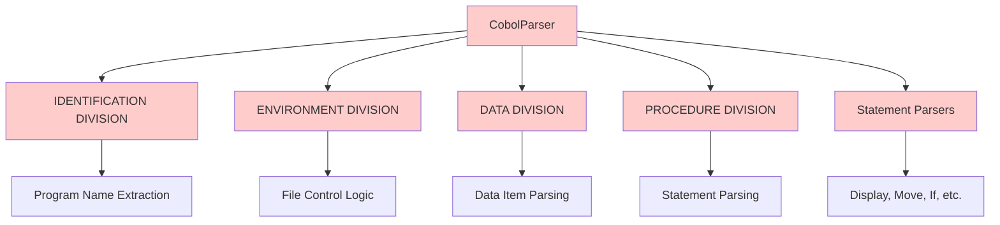
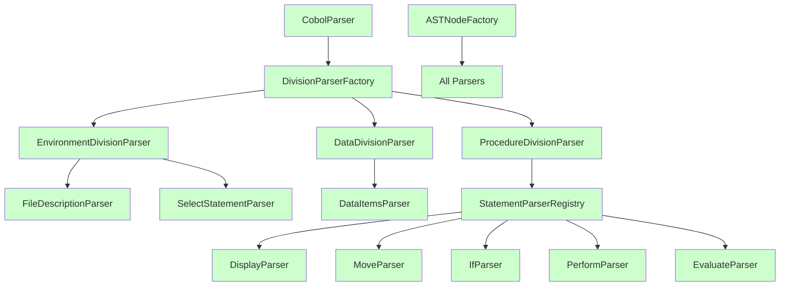

# COBOL Parser Refactoring Architecture

## Current Architecture vs Proposed Architecture

### Current Architecture


### Proposed Architecture


## Key Architectural Changes

### 1. Division Parser Layer
- **EnvironmentDivisionParser**: Handles FILE-CONTROL, SELECT statements, and file descriptions
- **DataDivisionParser**: Manages data items, working storage, and linkage sections
- **ProcedureDivisionParser**: Orchestrates statement parsing and control flow

### 2. Statement Parser Registry
- Centralized registry for all statement parsers
- Dynamic parser selection based on token stream
- Improved testability and isolation

### 3. AST Node Factory
- Consistent node creation across all parsers
- Centralized validation and error handling
- Easier extension for new node types

### 4. Factory Pattern
- DivisionParserFactory for creating appropriate division parsers
- StatementParserFactory for statement parser instantiation
- ASTNodeFactory for node creation

## Benefits of New Architecture

1. **Reduced Complexity**: CobolParser reduced from 7,500+ to <1,000 lines
2. **Improved Testability**: Each component can be tested in isolation
3. **Better Maintainability**: Clear separation of concerns
4. **Easier Extension**: New dialects and statements can be added without modifying core
5. **Enhanced Performance**: More efficient parsing through better organization
6. **Better Error Handling**: Centralized error management

## SOLID Principles Implementation

### Single Responsibility Principle (SRP)

**Concrete Implementation:**
```python
# core/interfaces.py
from abc import ABC, abstractmethod
from typing import List, Optional

class IDivisionParser(ABC):
    """Handles parsing of a single COBOL division."""
    
    @abstractmethod
    def parse(self, token_stream: "TokenStream") -> "ASTNode":
        """Parse the division from the token stream."""
        pass
    
    @abstractmethod
    def can_parse(self, token_stream: "TokenStream") -> bool:
        """Check if this parser can handle the current division."""
        pass

class IStatementParser(ABC):
    """Handles parsing of a single COBOL statement."""
    
    @abstractmethod
    def parse(self, token_stream: "TokenStream") -> "ASTNode":
        """Parse the statement from the token stream."""
        pass
    
    @abstractmethod
    def matches(self, token_stream: "TokenStream") -> bool:
        """Check if this parser matches the current statement."""
        pass
```

### Open/Closed Principle (OCP)

**Factory Pattern Implementation:**
```python
# core/parser_factory.py
from typing import Dict, Type
from .interfaces import IDivisionParser, IStatementParser

class DivisionParserFactory:
    """Factory for creating division parsers."""
    
    _PARSERS: Dict[str, Type[IDivisionParser]] = {
        "IDENTIFICATION": IdentificationDivisionParser,
        "ENVIRONMENT": EnvironmentDivisionParser,
        "DATA": DataDivisionParser,
        "PROCEDURE": ProcedureDivisionParser,
    }
    
    @classmethod
    def create_parser(cls, division_name: str) -> IDivisionParser:
        """Create a parser for the specified division."""
        parser_class = cls._PARSERS.get(division_name.upper())
        if not parser_class:
            raise ValueError(f"Unknown division: {division_name}")
        return parser_class()

class StatementParserFactory:
    """Factory for creating statement parsers."""
    
    _PARSERS: Dict[str, Type[IStatementParser]] = {
        "DISPLAY": DisplayStatementParser,
        "MOVE": MoveStatementParser,
        "IF": IfStatementParser,
        "PERFORM": PerformStatementParser,
        "EVALUATE": EvaluateStatementParser,
    }
    
    @classmethod
    def create_parser(cls, statement_name: str) -> IStatementParser:
        """Create a parser for the specified statement."""
        parser_class = cls._PARSERS.get(statement_name.upper())
        if not parser_class:
            raise ValueError(f"Unknown statement: {statement_name}")
        return parser_class()
```

### Liskov Substitution Principle (LSP)

**Interface Implementation:**
```python
# parsers/divisions/identification.py
from core.interfaces import IDivisionParser
from models.program import ProgramNode

class IdentificationDivisionParser(IDivisionParser):
    """Parses IDENTIFICATION DIVISION."""
    
    def parse(self, token_stream: "TokenStream") -> ProgramNode:
        # Implementation that adheres to the interface contract
        program_name = self._extract_program_name(token_stream)
        return ProgramNode(name=program_name)
    
    def can_parse(self, token_stream: "TokenStream") -> bool:
        # Implementation that adheres to the interface contract
        return token_stream.peek().value.upper() == "IDENTIFICATION"
    
    def _extract_program_name(self, token_stream: "TokenStream") -> str:
        # Concrete implementation details
        pass
```

### Interface Segregation Principle (ISP)

**Minimal Interfaces:**
```python
# core/interfaces.py
class ITokenStream:
    """Minimal interface for token navigation."""
    
    def peek(self) -> "Token":
        """Look at the next token without consuming it."""
        pass
    
    def consume(self) -> "Token":
        """Consume and return the next token."""
        pass
    
    def expect(self, value: str) -> "Token":
        """Expect a specific token value."""
        pass

class IASTNode:
    """Minimal interface for AST nodes."""
    
    def to_dict(self) -> dict:
        """Convert node to dictionary representation."""
        pass
```

### Dependency Inversion Principle (DIP)

**Abstractions First:**
```python
# cobolparser.py
from core.parser_factory import DivisionParserFactory
from core.interfaces import IDivisionParser

class CobolParser:
    """Main parser that depends on abstractions."""
    
    def __init__(self, token_stream: "TokenStream"):
        self._token_stream = token_stream
        self._division_parsers: List[IDivisionParser] = []
    
    def parse(self) -> "ProgramNode":
        """Parse the entire COBOL program."""
        while not self._token_stream.is_empty():
            division_name = self._detect_division()
            parser = DivisionParserFactory.create_parser(division_name)
            self._division_parsers.append(parser)
        
        # Delegate to division parsers
        return self._orchestrate_parsing()
    
    def _detect_division(self) -> str:
        """Detect the current division."""
        # Implementation that depends on abstractions
        pass
```

## Clean Code Practices

### Naming Conventions

**Class Names:**
- `IdentificationDivisionParser` - Descriptive, follows PascalCase
- `DisplayStatementParser` - Clear purpose, follows PascalCase
- `TokenStream` - Represents the concept, follows PascalCase

**Method Names:**
- `parse_division()` - Action verb, clear purpose
- `can_parse()` - Boolean method, clear intent
- `_extract_program_name()` - Private method, clear action

**Variable Names:**
- `token_stream` - Descriptive, follows snake_case
- `division_parsers` - Clear collection name
- `program_name` - Specific purpose

### Code Organization

**Directory Structure:**
```
cobolparser/
├── core/           # Core abstractions and interfaces
├── parsers/        # Concrete parser implementations
│   ├── divisions/  # Division-specific parsers
│   └── statements/ # Statement-specific parsers
├── models/         # AST node definitions
├── tests/          # Test suites
└── cobolparser.py  # Main entry point
```

**File Organization:**
- Each class in its own file
- Related classes grouped in directories
- Clear separation between interfaces and implementations

### Documentation

**Docstring Standards:**
```python
class IdentificationDivisionParser(IDivisionParser):
    """Parses IDENTIFICATION DIVISION of COBOL programs.
    
    This parser extracts program metadata including program name,
    author information, and installation details.
    
    Args:
        token_stream: The token stream to parse from.
    
    Returns:
        ProgramNode: The parsed program metadata.
    
    Raises:
        ParseError: If the division cannot be parsed correctly.
    """
    pass
```

**Type Hints:**
```python
def parse(self, token_stream: "TokenStream") -> ProgramNode:
    """Parse the IDENTIFICATION DIVISION."""
    pass

def create_parser(cls, division_name: str) -> IDivisionParser:
    """Create a parser for the specified division."""
    pass
```

## TDD Implementation Strategy

### Test-Driven Development Approach

**Red-Green-Refactor Cycle:**
1. **Red**: Write failing tests for new functionality
2. **Green**: Implement minimal code to pass tests
3. **Refactor**: Improve code while maintaining test coverage

### Test Categories

**Unit Tests:**
```python
# tests/unit/test_identification.py
import pytest
from parsers.divisions.identification import IdentificationDivisionParser
from core.token_stream import TokenStream

class TestIdentificationDivisionParser:
    def test_parses_program_name(self):
        """Test that program name is correctly extracted."""
        # Arrange
        tokens = [
            Token("IDENTIFICATION"),
            Token("DIVISION"),
            Token("PROGRAM-ID."),
            Token("TEST-PROGRAM"),
            Token(".")
        ]
        token_stream = TokenStream(tokens)
        parser = IdentificationDivisionParser()
        
        # Act
        result = parser.parse(token_stream)
        
        # Assert
        assert result.name == "TEST-PROGRAM"
    
    def test_handles_missing_program_id(self):
        """Test that missing PROGRAM-ID raises appropriate error."""
        # Arrange
        tokens = [
            Token("IDENTIFICATION"),
            Token("DIVISION"),
            Token("AUTHOR."),
            Token("JOHN DOE"),
            Token(".")
        ]
        token_stream = TokenStream(tokens)
        parser = IdentificationDivisionParser()
        
        # Act & Assert
        with pytest.raises(ParseError, match="PROGRAM-ID required"):
            parser.parse(token_stream)
```

**Integration Tests:**
```python
# tests/integration/test_full_parsing.py
import pytest
from cobolparser import CobolParser
from core.token_stream import TokenStream

class TestFullParsing:
    def test_parses_complete_program(self):
        """Test that complete COBOL program is parsed correctly."""
        # Arrange
        cobol_code = """
        IDENTIFICATION DIVISION.
        PROGRAM-ID. TEST-PROGRAM.
        
        ENVIRONMENT DIVISION.
        CONFIGURATION SECTION.
        INPUT-OUTPUT SECTION.
        FILE-CONTROL.
        SELECT TEST-FILE ASSIGN TO "test.txt".
        
        DATA DIVISION.
        FILE SECTION.
        FD TEST-FILE.
        01 TEST-RECORD.
        02 TEST-FIELD PIC X(10).
        
        PROCEDURE DIVISION.
        MAIN-PARAGRAPH.
        DISPLAY "Hello, World!".
        STOP RUN.
        """
        
        # Act
        parser = CobolParser(TokenStream.from_string(cobol_code))
        program = parser.parse()
        
        # Assert
        assert program.name == "TEST-PROGRAM"
        assert len(program.divisions) == 4
        assert len(program.statements) == 2
```

**Edge Case Tests:**
```python
# tests/unit/test_edge_cases.py
import pytest
from parsers.divisions.data import DataDivisionParser
from core.token_stream import TokenStream

class TestDataDivisionEdgeCases:
    def test_handles_empty_data_division(self):
        """Test that empty DATA DIVISION is handled gracefully."""
        tokens = [
            Token("DATA"),
            Token("DIVISION"),
            Token(".")
        ]
        token_stream = TokenStream(tokens)
        parser = DataDivisionParser()
        
        result = parser.parse(token_stream)
        assert result.data_items == []
    
    def test_handles_nested_occurrences(self):
        """Test that nested OCCURS clauses are parsed correctly."""
        # Complex test case for nested OCCURS
        pass
```

### Test Coverage Goals

**Coverage Metrics:**
- **Line Coverage**: 100% for all parser classes
- **Branch Coverage**: 100% for critical decision points
- **Function Coverage**: 100% for all public methods
- **Edge Case Coverage**: Comprehensive boundary condition testing

**Coverage Tools:**
```toml
# pyproject.toml
[tool.coverage.run]
source = ["cobolparser"]
omit = [
    "*/tests/*",
    "*/__init__.py"
]

[tool.coverage.report]
exclude_lines = [
    "pragma: no cover",
    "def __repr__",
    "if self.debug:",
    "if settings.DEBUG",
    "raise AssertionError",
    "raise NotImplementedError",
    "if 0:",
    "if __name__ == .__main__.:",
    "class .*\\bProtocol\\):",
    "@(abc\\.)?abstractmethod",
]
```

## Migration Strategy

The refactoring will be implemented in phases:

1. **Foundation Phase**: Create new directory structure and base classes
2. **Extraction Phase**: Move SELECT and FD logic to dedicated parsers
3. **Orchestration Phase**: Refactor CobolParser to delegate to division parsers
4. **Factory Phase**: Implement ASTNodeFactory and refactor node creation
5. **Validation Phase**: Comprehensive testing and performance benchmarking

### Phase 1: Foundation Setup

**Tasks:**
1. Create new directory structure
2. Set up test framework (pytest)
3. Create base interfaces and abstract classes
4. Implement TokenStream tests

**Concrete Implementation:**
```python
# core/token_stream.py
class TokenStream:
    """Token stream abstraction for parsing."""
    
    def __init__(self, tokens: List["Token"]):
        self._tokens = tokens
        self._position = 0
    
    def peek(self) -> "Token":
        """Look at the next token without consuming it."""
        if self._position >= len(self._tokens):
            raise ParseError("Unexpected end of input")
        return self._tokens[self._position]
    
    def consume(self) -> "Token":
        """Consume and return the next token."""
        token = self.peek()
        self._position += 1
        return token
    
    def expect(self, value: str) -> "Token":
        """Expect a specific token value."""
        token = self.peek()
        if token.value.upper() != value.upper():
            raise ParseError(f"Expected {value}, got {token.value}")
        return self.consume()
    
    def is_empty(self) -> bool:
        """Check if the stream is empty."""
        return self._position >= len(self._tokens)
```

### Phase 2: Division Parsers

**Tasks:**
1. Create IdentificationDivisionParser with tests
2. Create EnvironmentDivisionParser with tests
3. Create DataDivisionParser with tests
4. Create ProcedureDivisionParser with tests

**Concrete Implementation:**
```python
# parsers/divisions/identification.py
from core.interfaces import IDivisionParser
from models.program import ProgramNode
from core.exceptions import ParseError

class IdentificationDivisionParser(IDivisionParser):
    """Parses IDENTIFICATION DIVISION."""
    
    def parse(self, token_stream: "TokenStream") -> ProgramNode:
        """Parse the IDENTIFICATION DIVISION."""
        token_stream.expect("IDENTIFICATION")
        token_stream.expect("DIVISION")
        
        program_name = None
        author = None
        
        while not token_stream.is_empty():
            token = token_stream.peek()
            
            if token.value == "PROGRAM-ID":
                program_name = self._parse_program_id(token_stream)
            elif token.value == "AUTHOR":
                author = self._parse_author(token_stream)
            elif token.value == ".":
                token_stream.consume()
                break
            else:
                # Skip unknown entries
                self._skip_entry(token_stream)
        
        if not program_name:
            raise ParseError("PROGRAM-ID is required in IDENTIFICATION DIVISION")
        
        return ProgramNode(name=program_name, author=author)
    
    def can_parse(self, token_stream: "TokenStream") -> bool:
        """Check if this parser can handle the current division."""
        return token_stream.peek().value.upper() == "IDENTIFICATION"
    
    def _parse_program_id(self, token_stream: "TokenStream") -> str:
        """Parse PROGRAM-ID entry."""
        token_stream.expect("PROGRAM-ID")
        token_stream.expect(".")
        return token_stream.consume().value
    
    def _parse_author(self, token_stream: "TokenStream") -> str:
        """Parse AUTHOR entry."""
        token_stream.expect("AUTHOR")
        token_stream.expect(".")
        return token_stream.consume().value
    
    def _skip_entry(self, token_stream: "TokenStream") -> None:
        """Skip unknown entries."""
        while not token_stream.is_empty():
            if token_stream.peek().value == ".":
                token_stream.consume()
                break
            token_stream.consume()
```

### Phase 3: Statement Parsers

**Tasks:**
1. Migrate existing statement parsers with tests
2. Add new statement parsers following the pattern
3. Implement StatementFactory with tests

**Concrete Implementation:**
```python
# parsers/statements/display.py
from core.interfaces import IStatementParser
from models.statements import DisplayStatement
from core.exceptions import ParseError

class DisplayStatementParser(IStatementParser):
    """Parses DISPLAY statements."""
    
    def parse(self, token_stream: "TokenStream") -> DisplayStatement:
        """Parse the DISPLAY statement."""
        token_stream.expect("DISPLAY")
        
        # Parse what to display
        what_to_display = self._parse_display_content(token_stream)
        
        # Parse optional clauses
        upon = None
        with_no advancing = None
        
        while not token_stream.is_empty():
            token = token_stream.peek()
            
            if token.value == "UPON":
                upon = self._parse_upon_clause(token_stream)
            elif token.value == "WITH":
                with_no = self._parse_with_clause(token_stream)
            elif token.value == ".":
                token_stream.consume()
                break
            else:
                raise ParseError(f"Unexpected token: {token.value}")
        
        return DisplayStatement(
            what_to_display=what_to_display,
            upon=upon,
            with_no=with_no
        )
    
    def matches(self, token_stream: "TokenStream") -> bool:
        """Check if this parser matches the current statement."""
        return token_stream.peek().value.upper() == "DISPLAY"
    
    def _parse_display_content(self, token_stream: "TokenStream") -> str:
        """Parse what to display."""
        content = []
        while not token_stream.is_empty():
            token = token_stream.peek()
            if token.value in (".", "UPON", "WITH"):
                break
            content.append(token.value)
            token_stream.consume()
        return " ".join(content)
    
    def _parse_upon_clause(self, token_stream: "TokenStream") -> str:
        """Parse UPON clause."""
        token_stream.expect("UPON")
        return token_stream.consume().value
    
    def _parse_with_clause(self, token_stream: "TokenStream") -> str:
        """Parse WITH clause."""
        token_stream.expect("WITH")
        token_stream.expect("NO")
        return token_stream.consume().value
```

### Phase 4: Integration

**Tasks:**
1. Create simplified CobolParser entry point
2. Implement ParserFactory for division detection
3. Add integration tests for full parsing scenarios

**Concrete Implementation:**
```python
# cobolparser.py
from core.parser_factory import DivisionParserFactory
from core.token_stream import TokenStream
from core.exceptions import ParseError
from typing import List

class CobolParser:
    """Main COBOL parser that orchestrates division parsing."""
    
    def __init__(self, token_stream: TokenStream):
        self._token_stream = token_stream
        self._divisions: List["ASTNode"] = []
    
    def parse(self) -> "ProgramNode":
        """Parse the entire COBOL program."""
        program = ProgramNode()
        
        while not self._token_stream.is_empty():
            division_name = self._detect_division()
            if not division_name:
                raise ParseError(f"Unknown division at line {self._token_stream.line_number}")
            
            parser = DivisionParserFactory.create_parser(division_name)
            division = parser.parse(self._token_stream)
            program.add_division(division)
        
        return program
    
    def _detect_division(self) -> Optional[str]:
        """Detect the current division."""
        token = self._token_stream.peek()
        
        if token.value.upper() == "IDENTIFICATION":
            return "IDENTIFICATION"
        elif token.value.upper() == "ENVIRONMENT":
            return "ENVIRONMENT"
        elif token.value.upper() == "DATA":
            return "DATA"
        elif token.value.upper() == "PROCEDURE":
            return "PROCEDURE"
        
        return None
```

### Phase 5: Refactoring & Optimization

**Tasks:**
1. Optimize performance while maintaining test coverage
2. Add comprehensive error handling
3. Document public APIs

**Performance Optimizations:**
```python
# core/token_stream.py
class TokenStream:
    """Optimized token stream with lookahead."""
    
    def __init__(self, tokens: List["Token"], lookahead: int = 3):
        self._tokens = tokens
        self._position = 0
        self._lookahead = lookahead
        self._buffer = tokens[:lookahead]
    
    def peek(self, offset: int = 0) -> "Token":
        """Look ahead by offset."""
        index = self._position + offset
        if index >= len(self._tokens):
            raise ParseError("Unexpected end of input")
        return self._tokens[index]
    
    def consume(self) -> "Token":
        """Consume and return the next token with buffer optimization."""
        if self._position >= len(self._tokens):
            raise ParseError("Unexpected end of input")
        
        token = self._tokens[self._position]
        self._position += 1
        
        # Maintain buffer for lookahead
        if self._position + self._lookahead < len(self._tokens):
            self._buffer = self._tokens[self._position:self._position + self._lookahead]
        
        return token
```

## Quality Assurance

### Code Quality Metrics

**Static Analysis:**
```toml
# pyproject.toml
[tool.pylint.messages_control]
disable = "C0330, C0326"
enable = "useless-suppression"
max-line-length = 100

[tool.pylint.format]
max-line-length = 100

[tool.mypy]
python_version = "3.8"
warn_return_any = true
warn_unused_configs = true
disallow_untyped_defs = true
disallow_incomplete_defs = true
check_untyped_defs = true
disallow_untyped_decorators = true
no_implicit_optional = true
warn_redundant_casts = true
warn_unused_ignores = true
warn_no_return = true
warn_unreachable = true
strict_equality = true

[tool.black]
line-length = 100
target-version = ['py38']
```

### Performance Considerations

**Benchmarking:**
```python
# benchmarks/benchmark_parsing.py
import time
import pytest
from cobolparser import CobolParser
from core.token_stream import TokenStream

@pytest.mark.benchmark
def test_parsing_performance(benchmark):
    """Benchmark parsing performance."""
    # Load a large COBOL program
    with open("tests/fixtures/large_program.cbl", "r") as f:
        cobol_code = f.read()
    
    def parse_program():
        parser = CobolParser(TokenStream.from_string(cobol_code))
        return parser.parse()
    
    result = benchmark(parse_program)
    
    assert result is not None
    assert len(result.divisions) > 0
```

### Maintainability Features

**Error Handling:**
```python
# core/exceptions.py
class ParseError(Exception):
    """Base class for parsing errors."""
    
    def __init__(self, message: str, line_number: Optional[int] = None):
        self.message = message
        self.line_number = line_number
        super().__init__(self._format_message())
    
    def _format_message(self) -> str:
        """Format the error message with line number."""
        if self.line_number:
            return f"Parse error at line {self.line_number}: {self.message}"
        return f"Parse error: {self.message}"

class TokenNotFoundError(ParseError):
    """Raised when expected token is not found."""
    pass

class DivisionNotFoundError(ParseError):
    """Raised when division cannot be found."""
    pass
```

**Logging:**
```python
# core/logger.py
import logging

class ParserLogger:
    """Logger for parser operations."""
    
    def __init__(self):
        self._logger = logging.getLogger("cobolparser")
        self._logger.setLevel(logging.DEBUG)
        
        # Console handler
        ch = logging.StreamHandler()
        ch.setLevel(logging.DEBUG)
        
        # Formatter
        formatter = logging.Formatter(
            '%(asctime)s - %(name)s - %(levelname)s - %(message)s'
        )
        ch.setFormatter(formatter)
        
        self._logger.addHandler(ch)
    
    def debug(self, message: str):
        """Log debug message."""
        self._logger.debug(message)
    
    def info(self, message: str):
        """Log info message."""
        self._logger.info(message)
    
    def warning(self, message: str):
        """Log warning message."""
        self._logger.warning(message)
    
    def error(self, message: str):
        """Log error message."""
        self._logger.error(message)
```

This enhanced refactoring plan provides concrete implementation details, specific examples, and actionable guidance for each principle, making it a comprehensive blueprint for the COBOL parser refactoring project.